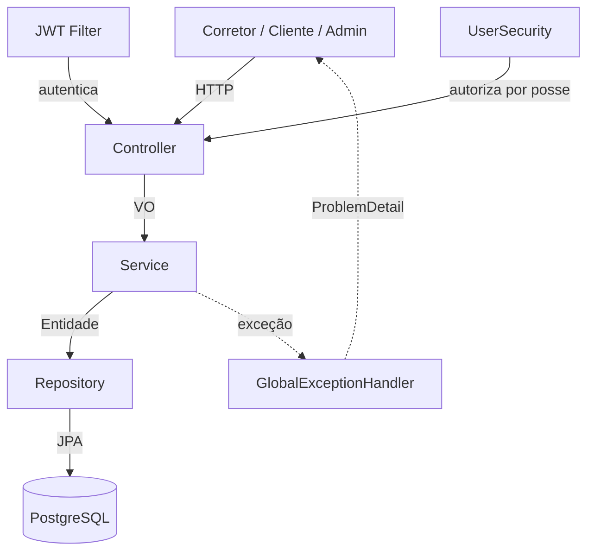
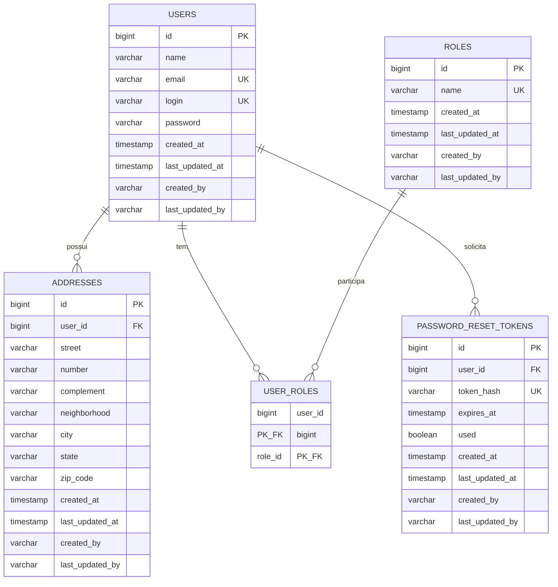
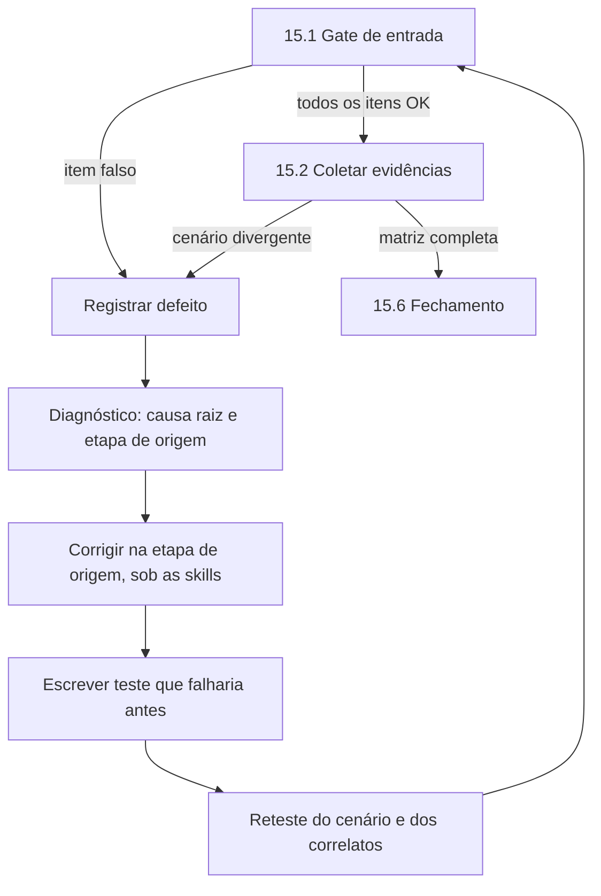

# Relatório Técnico — Projeto Corretoria
## Plataforma unificada de corretores, clientes e administração

**Autor:** Felipe Dias Mac Dowell

**Stack:** Java 21 · Spring Boot 3.5.x · PostgreSQL 16 · Docker
**Versão do relatório:** 1.0

> **Documento vivo.** O Sumário de Progresso abaixo é o plano de trabalho e o registro da
> execução. Cada etapa corresponde a uma seção homônima neste relatório e tem seu status
> atualizado conforme a execução avança.

---

## Contexto do Projeto

**Corretoria** é um sistema que reúne **todos os corretores em um só lugar**. Em vez de cada
corretor manter sua própria operação isolada, a plataforma centraliza o cadastro dos
profissionais, dos clientes e a administração de todos eles sob uma identidade e um controle
de acesso únicos.

A entrega é a **plataforma de identidade da Corretoria**: autocadastro, autenticação,
autorização, gestão de usuários pelo administrador, auditoria de escrita, versionamento de
schema e uma API REST versionada e documentada.

### Papéis e responsabilidades

| Papel | Constante | Responsabilidades |
|-------|-----------|-------------------|
| **Corretor** | `ROLE_REALTOR` | Autocadastra-se como profissional na plataforma, autentica-se e gerencia o próprio cadastro: dados pessoais, endereços e senha. |
| **Administrador** | `ROLE_ADMIN` | **Gerencia os demais usuários**: consulta, busca, lista, atualiza e remove qualquer conta de corretor ou cliente. É a única via de concessão de papéis privilegiados. |
| **Cliente** | `ROLE_CUSTOMER` | Autocadastra-se, autentica-se e gerencia o próprio cadastro: dados pessoais, endereços e senha. |

> Um mesmo usuário pode acumular papéis (ex.: um corretor que também é cliente), pois os
> papéis são persistidos em tabela associativa — não em coluna enum única.

### Matriz de permissões

| Operação | `ROLE_REALTOR` | `ROLE_CUSTOMER` | `ROLE_ADMIN` |
|----------|:--------------:|:---------------:|:------------:|
| Autocadastro público | ✅ | ✅ | ❌ *(só por seed/fluxo autenticado)* |
| Autenticar (login) | ✅ | ✅ | ✅ |
| Consultar/atualizar **o próprio** cadastro | ✅ | ✅ | ✅ |
| Trocar a própria senha | ✅ | ✅ | ✅ |
| Excluir o próprio cadastro | ✅ | ✅ | ✅ |
| Consultar cadastro de **outro** usuário | ❌ | ❌ | ✅ |
| Listar / buscar usuários | ❌ | ❌ | ✅ |
| Atualizar / excluir qualquer usuário | ❌ | ❌ | ✅ |

---

## Sumário de Progresso

| # | Etapa | Depende de | Status |
|---|-------|------------|--------|
| 1 | Governança por Skills (nomenclatura, arquitetura, Java/SOLID) | — | ✅ |
| 2 | Setup do Projeto | 1 | ✅ |
| 3 | Execução com Docker Compose | 2 | ✅ |
| 4 | Modelagem das Entidades e Banco de Dados | 2 | ✅ |
| 5 | Migrations e Seeds (Flyway) | 3, 4 | ✅ |
| 6 | Repositories | 5 | ✅ |
| 7 | Value Objects e Validação | 4 | ⏳ |
| 8 | Tratamento de Erros (ProblemDetail) | 7 | ⏳ |
| 9 | Login, Security e JWT | 6, 8 | ⏳ |
| 10 | Services (regras de negócio) | 6, 7, 8, 9 | ⏳ |
| 11 | Controllers Versionados (Endpoints) | 8, 10 | ⏳ |
| 12 | Testes (JUnit + Mockito + ArchUnit) | 10, 11 | ⏳ |
| 13 | Documentação Swagger | 11 | ⏳ |
| 14 | Entregáveis (Postman, README) | 11, 12, 13 | ⏳ |
| 15 | Revisão, Evidências e Manutenção | 1–14 | ⏳ |

**Progresso:** 6 de 15 etapas concluídas.
**Legenda:** ✅ concluída · 🔄 em andamento · ⏳ pendente.

### Lógica do sequenciamento

A ordem segue as **dependências reais de execução**, não a ordem em que os assuntos são
normalmente ensinados:

- **Governança antes de código (1).** As três skills definem nomenclatura, camadas e estilo.
  Se entrassem no fim, todo o código nasceria sem elas e precisaria ser reescrito — o padrão
  tem que existir antes do primeiro pacote.
- **Docker antes das migrations (3 antes de 5).** O Flyway aplica os scripts contra um
  PostgreSQL em execução, e o Hibernate roda em `ddl-auto: validate`. Sem o serviço `db` no
  ar, nem as migrations nem os repositories podem ser exercitados.
- **Erros antes dos serviços (8 antes de 10).** As exceções de domínio são **lançadas** pelos
  services; elas e o handler global precisam existir antes, senão o service nasce lançando
  exceção genérica e é refatorado depois.
- **Security antes dos serviços (9 antes de 10).** O `UserService` depende do
  `PasswordEncoder`, que é um bean declarado no `SecurityConfig`.
- **Fluxo de dentro para fora (4 → 6 → 7 → 11).** Domínio, persistência, contrato e
  apresentação, na direção da regra de dependência da arquitetura em camadas.
- **Testes contínuos, não finais (12).** O `ArchitectureTest` nasce no scaffold da Etapa 2 e
  roda desde o primeiro commit; os testes unitários acompanham cada regra de negócio. A
  Etapa 12 é a consolidação e o fechamento da suíte, não o momento em que os testes começam.
- **Revisão por último, e sem exceção (15).** A etapa final só produz as evidências depois de
  verificar que tudo está implementado; quando não está, ela devolve o trabalho às etapas de
  origem em rodadas de manutenção. É a única etapa que pode reabrir uma etapa já concluída.

---

## Mapa dos Entregáveis Obrigatórios

| Entregável obrigatório | Onde encontrar |
|------------------------|----------------|
| Contexto e papéis de usuário | Contexto do Projeto |
| Descrição detalhada da arquitetura | Visão Geral da Arquitetura |
| Modelagem das entidades e relacionamentos | Etapa 4 |
| Estrutura do banco de dados (tabelas) | Etapa 4 |
| Descrição dos endpoints (com exemplos) | Etapas 9 e 11 |
| Documentação Swagger | Etapa 13 |
| Coleção Postman | Etapa 14 |
| Passo a passo com Docker Compose | Etapa 3 |
| Padrão de nomenclatura e guardas de arquitetura | Etapa 1 |
| Prints dos endpoints em funcionamento (todos os retornos) | Etapa 15 |

---

## Visão Geral da Arquitetura

### Padrão arquitetural adotado

A aplicação adota uma **Arquitetura em Camadas (Layered Architecture)**, organizada em
quatro camadas principais com responsabilidades bem definidas, somadas a componentes
transversais (configuração, segurança e tratamento de erros).

A escolha por arquitetura em camadas — em vez de Hexagonal ou Clean Architecture — se
justifica pelo escopo do projeto: um backend de identidade e gestão de usuários com regras de
negócio diretas. A arquitetura em camadas entrega a separação de responsabilidades exigida
pelos princípios SOLID com baixa complexidade acidental, mantendo o código legível, testável
e de fácil evolução.

### Camadas

| Camada | Pacote | Responsabilidade |
|--------|--------|------------------|
| Apresentação (API) | `controller` | Expõe os endpoints REST versionados, recebe/retorna VOs, delega para os Services. Não contém regra de negócio. |
| Negócio (Aplicação) | `service` | Concentra as regras de negócio: unicidade de e-mail e login, validação de credenciais, autocadastro restrito, troca de senha, busca por nome. |
| Persistência | `repository` | Abstrai o acesso ao banco via Spring Data JPA. |
| Domínio | `entity`, `enums` | Modelo de domínio (entidades JPA e papéis). |

### Componentes transversais

| Componente | Pacote | Responsabilidade |
|------------|--------|------------------|
| VOs | `vo` | Contratos de entrada e saída da API, desacoplados das entidades. |
| Tratamento de erros | `exception` | Handler global que padroniza respostas de erro no formato ProblemDetail (RFC 7807). |
| Segurança | `security` | Filtro de autenticação JWT, utilitários de token e bean de posse (`UserSecurity`). |
| Configuração | `config` | Configuração do Spring Security e do OpenAPI/Swagger. |
| Utilitários | `util` | Funções transversais (normalização de texto, verificações). |

### Fluxo de uma requisição

```
Cliente HTTP
    │
    ▼
[Controller]  ──valida VO de entrada──►  [Service]  ──regras de negócio──►  [Repository]
    ▲                                          │                                   │
    │                                          ▼                                   ▼
    └──────────  VO de saída  ◄────── mapeamento ◄────── Entidade ◄──────────  PostgreSQL
```

Em caso de erro em qualquer ponto, a exceção é capturada pelo handler global e convertida
em uma resposta padronizada `ProblemDetail`.

### Diagrama de componentes (Mermaid)



---

## Etapa 1 — Governança por Skills

**Primeira etapa por decisão de projeto:** o padrão precisa existir antes da primeira linha
de código. Três skills mantêm a integridade do projeto ao longo do tempo. Ficam versionadas
em `corretoria/.claude/skills/`, entram no repositório no commit inicial e são acionadas em
toda nova implementação — inclusive na Etapa 2, que cria a estrutura de pacotes já sob as
convenções definidas aqui.

| Skill | Responsabilidade | Aciona quando |
|-------|------------------|---------------|
| `corretoria-naming-standards` | Padrão único de nomenclatura em todas as frentes: Java, banco, API, JSON, Flyway, Git, testes, Docker | Criar/renomear qualquer artefato, ou revisar nomes |
| `corretoria-architecture-guard` | Regras da arquitetura em camadas e seu enforcement automatizado com ArchUnit | Criar classe/pacote, mudar dependência entre camadas, escrever/ajustar testes de arquitetura |
| `corretoria-java-clean-solid` | Boas práticas de **Java 21**, clean code e SOLID | **Toda** nova implementação ou refatoração de código Java |

### Padrão de nomenclatura consolidado (resumo)

| Frente | Convenção | Exemplo |
|--------|-----------|---------|
| Pacote | minúsculo, sem underscore, **singular** | `com.corretoria.service` |
| Entidade JPA | `PascalCase`, **singular** | `User`, `Address`, `PasswordResetToken` |
| Tabela | `snake_case`, **plural** | `users`, `password_reset_tokens` |
| Coluna | `snake_case` | `zip_code`, `last_updated_at` |
| Constraint | `pk_` / `fk_` / `uk_` / `ck_` / `idx_` + tabela + colunas | `uk_users_email` |
| Enum | `PascalCase` singular; constantes `UPPER_SNAKE` | `RoleName.ROLE_REALTOR` |
| Papel | `ROLE_` + substantivo em inglês | `ROLE_REALTOR` |
| VO de entrada | `<Agregado><Ação>Request` | `UserRegistrationRequest` |
| VO de saída | `<Agregado>[Qualificador]Response` | `UserResponse` |
| Controller/Service/Repository/Mapper | `<Agregado>` + sufixo da camada | `UserController`, `UserService` |
| Exceção | terminada em `Exception`, sem prefixo redundante | `DuplicateResourceException` |
| Rota REST | `/api/v{n}/` + substantivo **plural** em `kebab-case` | `/api/v1/users/{id}/password` |
| Campo JSON | `camelCase` | `lastUpdatedAt` |
| Migration | `V<n>__<verbo>_<objeto>.sql` | `V5__add_audit_columns.sql` |
| Teste | `<ClasseSobTeste>Test` | `UserServiceTest` |
| Variável de ambiente | `UPPER_SNAKE_CASE` | `JWT_EXPIRATION` |
| Branch Git | `<tipo>/<escopo>-<descrição-curta>` | `feat/user-password-change` |

A skill de nomenclatura contém a tabela completa, os antipadrões proibidos e o **glossário
canônico** (`realtor`, `customer`, `admin`, `user`, `role`, `address`) que impede sinônimos
concorrentes (`broker`, `agent`, `client`, `perfil`, `usuario`) de entrarem no código.

### Entrega da etapa ✅

Arquivos versionados no repositório:

```
corretoria/.claude/skills/
├── corretoria-naming-standards/SKILL.md
├── corretoria-java-clean-solid/SKILL.md
└── corretoria-architecture-guard/
    ├── SKILL.md
    └── reference/ArchitectureTest.java
```

O `reference/ArchitectureTest.java` é a referência compilável citada em §5 da skill de
arquitetura: contém as 30 regras de ArchUnit já escritas, com mensagem de falha em português.
É a fonte de onde a Etapa 2 copiou o `ArchitectureTest` para o scaffold — evitando que a
tabela de regras da skill e o teste real divirjam.

---

## Etapa 2 — Setup do Projeto

### Stack e dependências

| Tecnologia | Versão | Uso |
|------------|--------|-----|
| Java | 21 (LTS) | Linguagem |
| Spring Boot | 3.5.x | Framework base |
| Spring Web | (gerenciado) | API REST |
| Spring Data JPA | (gerenciado) | Persistência |
| Spring Validation | (gerenciado) | Validação de VOs |
| Spring Security | (gerenciado) | Autenticação JWT |
| PostgreSQL | 16 | Banco relacional |
| springdoc-openapi | 2.8.x | Documentação Swagger |
| jjwt | 0.12.x | Geração/validação de JWT |
| Flyway | (gerenciado) | Migração e versionamento de schema |
| Spring HATEOAS | (gerenciado) | Links de navegação nas respostas REST |
| Spring Boot Actuator | (gerenciado) | Observabilidade (health, info, metrics) |
| MapStruct | 1.6.x | Mapeamento VO ↔ entidade (geração em compilação) |
| Lombok | (gerenciado) | Redução de boilerplate |
| JUnit 5 + Mockito | (gerenciado) | Testes |
| ArchUnit | 1.4.x | Testes automatizados de regras de arquitetura |

### Estrutura de pacotes

Raiz: `com.corretoria`

```
src/main/java/com/corretoria/
├── CorretoriaApplication.java
├── config/
├── controller/          # AuthController, UserController
├── entity/              # Auditable, User, Role, Address, PasswordResetToken
├── enums/               # RoleName
├── exception/
├── mapper/              # mapeadores MapStruct (VO ↔ entidade)
├── repository/
├── security/
├── service/
├── util/                # TextUtils, ObjectUtils (funções transversais)
└── vo/                  # Value Objects (records imutáveis)
    ├── shared/          # VOs de valor estáveis: Email, ZipCode
    └── v1/              # VOs de contrato, versionados junto com a API
        ├── request/     # VOs de entrada (sufixo Request)
        └── response/    # VOs de saída (sufixo Response)
```

### Guarda de arquitetura desde o commit inicial

O scaffold já inclui `src/test/java/com/corretoria/architecture/ArchitectureTest.java` com as
regras de ArchUnit definidas na Etapa 1. Criá-lo agora — e não junto com os testes unitários
da Etapa 12 — faz com que qualquer violação da regra de dependência quebre o build **no
commit em que é introduzida**, e não semanas depois. As regras são ampliadas conforme novos
pacotes aparecem; o detalhamento da suíte está na Etapa 12.

### Entrega da etapa ✅

Scaffold criado e verificado: `mvn clean test` → **BUILD SUCCESS, 30 testes, 0 falhas**,
todos do `ArchitectureTest`. Versões efetivamente resolvidas: Spring Boot 3.5.3,
ArchUnit 1.4.1, MapStruct 1.6.3, jjwt 0.12.6, springdoc 2.8.6.

Além do previsto, o scaffold inclui `application.yml` (datasource por variável de ambiente,
`ddl-auto: validate`, Flyway, Actuator, springdoc e `corretoria.jwt.*`), `.gitignore` e o
`archunit.properties` de teste.

#### Armadilha encontrada: build verde sem executar regra nenhuma

O `maven-surefire-plugin` **3.5.3** — versão gerenciada pelo Spring Boot 3.5.3 — descarta
silenciosamente os descritores de teste baseados em campo da engine do ArchUnit. O resultado
é `Tests run: 0` com **BUILD SUCCESS**: a guarda de arquitetura parece instalada, mas nenhuma
regra é checada. Diagnóstico: a engine do ArchUnit descobre as 30 regras normalmente quando
acionada pelo JUnit Platform Launcher, e o mesmo teste passa a rodar ao trocar o Surefire.

Correção: `pom.xml` fixa `maven-surefire-plugin` em **3.5.2**, a versão mais recente que
executa os `@ArchTest`. A armadilha está registrada na skill `corretoria-architecture-guard`
com a regra prática: **conferir a contagem de testes, não só o `BUILD SUCCESS`**.

#### Relaxamentos temporários (remover na Etapa 12)

Com os pacotes ainda vazios, o padrão do ArchUnit é reprovar por ausência de código — o que
faria o `ArchitectureTest` falhar por não haver classes, não por violação:

| Relaxamento | Onde |
|-------------|------|
| `archRule.failOnEmptyShould=false` | `src/test/resources/archunit.properties` |
| `.withOptionalLayers(true)` | regra `layeredArchitecture()` do `ArchitectureTest` |

#### Maven Wrapper

O repositório inclui o **Maven Wrapper** (`mvnw`, `mvnw.cmd`,
`.mvn/wrapper/maven-wrapper.properties`, Maven 3.9.11, `distributionType=only-script`). Quem
clonar o projeto não precisa ter Maven instalado — o wrapper baixa a distribuição correta na
primeira execução, e todos usam a mesma versão de Maven:

```bash
./mvnw clean test        # Linux/macOS
mvnw.cmd clean test      # Windows
```

Só é exigido um **JDK 21** com `JAVA_HOME` apontado para ele.

---

## Etapa 3 — Execução com Docker Compose

Esta etapa vem antes da modelagem física e das migrations porque o **PostgreSQL precisa estar
em execução** para que o Flyway aplique os scripts (Etapa 5) e para que o Hibernate valide as
entidades contra o schema (`ddl-auto: validate`). Durante o desenvolvimento, sobe-se apenas o
serviço `db`; o serviço `app` passa a ser exercitado a partir da Etapa 9, quando a aplicação
já inicializa com segurança configurada.

### Pré-requisitos
- Docker e Docker Compose instalados.

### Variáveis de ambiente

O projeto usa variáveis de ambiente com valores padrão (ver `.env.example`):

| Variável | Padrão | Descrição |
|----------|--------|-----------|
| `DB_NAME` | `corretoria-app` | Nome do banco |
| `DB_USER` | `postgres` | Usuário do banco |
| `DB_PASSWORD` | `postgres` | Senha do banco |
| `DB_HOST` | `localhost` (local) / `db` (compose) | Host do banco |
| `DB_PORT` | `5432` | Porta do banco |
| `JWT_SECRET` | *(valor de exemplo)* | Segredo de assinatura do JWT |
| `JWT_EXPIRATION` | `3600000` | Expiração do token em ms |

### Passo a passo

```bash
# 1. (Opcional) criar seu .env a partir do exemplo
cp .env.example .env

# 2. Subir apenas o banco (útil durante o desenvolvimento)
docker compose up -d db

# 3. Subir aplicação + banco juntos
docker compose up --build

# 4. Encerrar
docker compose down

# 4b. Encerrar e apagar os dados do banco
docker compose down -v
```

A aplicação ficará disponível em `http://localhost:8080` e o Swagger em
`http://localhost:8080/swagger-ui.html`.

### Entrega da etapa ✅

Arquivos criados: `docker-compose.yml`, `Dockerfile`, `.dockerignore` e `.env.example`.

#### Serviço `db`

`postgres:16`, contêiner `corretoria-db`, com **volume nomeado** `postgres-data` — os dados
sobrevivem a `docker compose down` e só são apagados com `down -v`.

O serviço declara um **healthcheck** (`pg_isready`) e o `app` depende dele com
`condition: service_healthy`. Sem isso o `depends_on` só garante que o contêiner do banco
*iniciou*, não que ele aceita conexão: o Flyway tentaria migrar contra um PostgreSQL que
ainda está subindo e a aplicação morreria no boot.

#### Serviço `app`

Build multi-estágio, imagem `corretoria-api:1.0.0`:

- **Estágio de build** sobre `maven:3.9-eclipse-temurin-21`. Não usa o `mvnw` de propósito:
  o wrapper é um script shell e, clonado no Windows, pode chegar ao contêiner com CRLF e
  falhar. O `pom.xml` é copiado antes do `src` para que a camada de dependências só seja
  reconstruída quando o `pom` mudar.
- **Estágio de runtime** sobre `eclipse-temurin:21-jre-alpine` (JRE, não JDK), com usuário
  não-root `corretoria`.

Dentro da rede do compose o host do banco é o **nome do serviço** (`DB_HOST=db`), não
`localhost` — daí a variável ter valor diferente conforme o app roda na máquina ou no compose.

#### Verificação executada

| Verificação | Resultado |
|-------------|-----------|
| `docker compose config` | válido; serviços `db` e `app` |
| `docker compose up -d db` | `corretoria-db` no ar |
| Healthcheck | `Up (healthy)` |
| Versão do banco | PostgreSQL **16.14** |
| Banco criado | `corretoria-app`, encoding UTF8 |
| Porta publicada | `0.0.0.0:5432` |
| Volume nomeado | `corretoria_postgres-data` |
| `docker compose build app` | imagem `corretoria-api:1.0.0` construída (544 MB) |

O serviço `app` foi **construído**, mas ainda não é executado: conforme o sequenciamento, ele
passa a ser exercitado na Etapa 9, quando a aplicação já inicializa com segurança configurada.

---

## Etapa 4 — Modelagem das Entidades e Banco de Dados

### Abordagem de projeto

O modelo será construído seguindo a divisão clássica de projeto de banco de dados em três
níveis — conceitual, lógico e físico (Machado) — e os princípios do modelo relacional,
normalização e integridade referencial (Date). O objetivo é um esquema **normalizado até a
3ª Forma Normal / BCNF**, já preparado para autenticação e autorização com Spring Security.

### Tabelas do modelo

| Tabela | Tipo | Responsabilidade |
|--------|------|------------------|
| `users` | Entidade forte | Identidade e credenciais do usuário (corretor, cliente ou admin) |
| `roles` | Entidade forte (lookup) | Papéis de autorização |
| `user_roles` | Tabela associativa | Resolve o N:M entre usuários e papéis |
| `addresses` | Entidade | Endereços do usuário (1:N) |
| `password_reset_tokens` | Entidade | Tokens de uso único para redefinição de senha (1:N com `users`) |

### Relacionamentos e cardinalidade

| Relacionamento | Cardinalidade | Implementação |
|----------------|---------------|---------------|
| `users` ↔ `addresses` | 1 : N | FK `addresses.user_id` (`@OneToMany`/`@ManyToOne`) |
| `users` ↔ `roles` | N : M | Tabela `user_roles` (`@ManyToMany` + `@JoinTable`) |
| `users` ↔ `password_reset_tokens` | 1 : N | FK `password_reset_tokens.user_id` (`@ManyToOne`) |

Regras de integridade referencial: `addresses.user_id`, `password_reset_tokens.user_id` e as
FKs de `user_roles` usam `ON DELETE CASCADE` — remover um usuário remove seus endereços,
seus tokens de redefinição de senha e seus vínculos de papel, sem deixar registros órfãos.

### Justificativa da normalização

- **1FN (atomicidade, sem grupos repetitivos):** papéis e endereços são extraídos para
  tabelas próprias. Mantê-los como colunas em `users` (ex.: `papel1`, `papel2`,
  `endereco1`…) violaria a 1FN. A associativa `user_roles` e a tabela `addresses` eliminam
  os grupos repetitivos.
- **2FN (sem dependência parcial):** a única chave composta é a de `user_roles`
  (`user_id`, `role_id`), que não possui atributos não-chave dependentes de parte da chave.
- **3FN (sem dependência transitiva):** em `users`, todo atributo depende apenas da PK. O
  nome do papel reside em `roles`, evitando repetir o texto do papel em cada vínculo.
- **BCNF:** `email` e `login` são chaves candidatas (únicas) de `users`; todo determinante é
  uma chave candidata.

### Decisão: papéis como tabela (não enum)

Os três tipos de usuário do Corretoria são modelados como **papéis** (`ROLE_REALTOR`,
`ROLE_CUSTOMER`, `ROLE_ADMIN`), persistidos na tabela `roles` e vinculados ao usuário via
`user_roles`. Essa escolha:

1. Atende ao requisito de "tabela de ROLE para controle dos papéis".
2. É exatamente a estrutura que o Spring Security consome para montar as autoridades
   (`GrantedAuthority`).
3. Permite que um usuário acumule papéis (ex.: um corretor que também atua como cliente) sem
   alteração de schema, diferentemente de um enum de coluna única.

### Auditoria

Todas as entidades (`User`, `Role`, `Address`, `PasswordResetToken`) estendem a classe base
`Auditable` (`@MappedSuperclass` + `@EntityListeners(AuditingEntityListener.class)`) e são
auditadas automaticamente via **Spring Data JPA Auditing** (`@EnableJpaAuditing`),
registrando em toda escrita:

- `created_at` (imutável) / `last_updated_at`, via `@CreatedDate`/`@LastModifiedDate` —
  atendendo ao requisito "registro da data da última alteração". Tipo usado:
  `LocalDateTime` (API moderna de data/hora do Java, em vez do legado `java.util.Date`).
- `created_by` (imutável) / `last_updated_by`, via `@CreatedBy`/`@LastModifiedBy` —
  registram **quem** criou/alterou o registro. Em uma plataforma multi-corretor isso é
  auditoria de negócio, não apenas técnica.

Essa abordagem substitui *callbacks* manuais de ciclo de vida do JPA
(`@PrePersist`/`@PreUpdate`) por um mecanismo declarativo único e uniforme entre todas as
entidades.

O valor de `created_by`/`last_updated_by` vem de um `AuditorAware<String>`
(`SpringSecurityAuditorAware`) que lê o login do usuário autenticado em
`SecurityContextHolder` — mesmo padrão de leitura usado em `UserSecurity.isSelf` — e cai
para `"system"` quando não há usuário autenticado (autocadastro público, seeds SQL).

### Diagrama Entidade-Relacionamento



### Estrutura do banco de dados (tabelas)

O schema será **gerenciado pelo Flyway** através de migrations SQL versionadas em
`src/main/resources/db/migration` (a primeira é `V1__create_initial_schema.sql`). O
Hibernate opera em modo `validate`: não altera o banco, apenas confere que as entidades
batem com o schema criado pelas migrations. Cada mudança futura entra como uma nova
migration (`V2`, `V3`…), nunca por alteração automática. DDL da migration inicial:

```sql
CREATE TABLE users (
    id              BIGINT GENERATED ALWAYS AS IDENTITY PRIMARY KEY,
    name            VARCHAR(255) NOT NULL,
    email           VARCHAR(255) NOT NULL UNIQUE,
    login           VARCHAR(255) NOT NULL UNIQUE,
    password        VARCHAR(255) NOT NULL,
    created_at      TIMESTAMP    NOT NULL,
    last_updated_at TIMESTAMP    NOT NULL
);

CREATE TABLE roles (
    id   BIGINT GENERATED ALWAYS AS IDENTITY PRIMARY KEY,
    name VARCHAR(50) NOT NULL UNIQUE  -- ROLE_REALTOR, ROLE_CUSTOMER, ROLE_ADMIN
);

CREATE TABLE user_roles (
    user_id BIGINT NOT NULL REFERENCES users (id) ON DELETE CASCADE,
    role_id BIGINT NOT NULL REFERENCES roles (id) ON DELETE CASCADE,
    PRIMARY KEY (user_id, role_id)
);

CREATE TABLE addresses (
    id           BIGINT GENERATED ALWAYS AS IDENTITY PRIMARY KEY,
    user_id      BIGINT       NOT NULL REFERENCES users (id) ON DELETE CASCADE,
    street       VARCHAR(255) NOT NULL,
    number       VARCHAR(255),
    complement   VARCHAR(255),
    neighborhood VARCHAR(255),
    city         VARCHAR(255) NOT NULL,
    state        VARCHAR(2)   NOT NULL,
    zip_code     VARCHAR(9)   NOT NULL
);
```

### Entrega da etapa ✅

Classes criadas:

| Classe | Pacote | Papel |
|--------|--------|-------|
| `RoleName` | `enums` | `ROLE_ADMIN`, `ROLE_REALTOR`, `ROLE_CUSTOMER` |
| `Auditable` | `entity` | `@MappedSuperclass` + `AuditingEntityListener` |
| `User` | `entity` | agregado raiz da identidade |
| `Role` | `entity` | papel persistido |
| `Address` | `entity` | endereço, filho do agregado `User` |
| `PasswordResetToken` | `entity` | token de redefinição, filho do agregado `User` |
| `SpringSecurityAuditorAware` | `security` | resolve o autor da escrita |

`mvn clean test` → **BUILD SUCCESS, 30 testes, 0 falhas**: as entidades entraram sem violar
nenhuma regra de arquitetura — em particular, nenhuma anotação de API (`@Schema`,
`@JsonProperty`, Bean Validation) vazou para o domínio e nada em `entity` aponta para camada
superior.

#### Decisões de mapeamento

- **`roles` em `FetchType.EAGER`.** Contraria o default recomendado, e é proposital: com
  `open-in-view: false`, o `CustomUserDetailsService` (Etapa 9) precisa das autoridades fora
  de transação a cada requisição. O conjunto é minúsculo (no máximo três papéis) e o custo é
  menor que o de um `LazyInitializationException` a cada login.
- **`addresses` em `LAZY`, com cascade e `orphanRemoval`.** Consequência a respeitar na
  Etapa 10: o service precisa carregar os endereços **dentro** da transação antes de mapear
  para VO, já que não há sessão aberta na camada web.
- **`replaceAddresses` reaproveita a lista gerenciada** (`clear()` + re-add) em vez de
  atribuir uma lista nova — trocar a referência faz o Hibernate perder o rastro dos órfãos e
  o `orphanRemoval` deixa de apagar os endereços antigos.
- **`equals`/`hashCode` por `id`**, nunca por coleção, e `id` nulo nunca é igual a `id` nulo:
  duas entidades ainda não persistidas são objetos distintos.
- **Construtor padrão `protected`**: exigido pelo JPA, mas fora do alcance do código de
  negócio, que usa os construtores com os campos obrigatórios.
- **`PasswordResetToken.isExpiredAt(LocalDateTime)`** recebe o instante em vez de chamar
  `LocalDateTime.now()`. A entidade guarda a regra; quem decide "agora" é o service, com um
  `Clock` injetado — do contrário a expiração seria intestável.

#### Dois pontos de atenção que a Etapa 5 precisa resolver

Ambos nascem do confronto entre o DDL planejado acima e o mapeamento agora escrito:

1. **`BIGINT GENERATED ALWAYS AS IDENTITY` rejeita id explícito no `INSERT`.** Os seeds
   (V2/V3) não podem fixar `id`, ou precisarão de `OVERRIDING SYSTEM VALUE`.
2. **As colunas de auditoria entram só na V5, como `NOT NULL`.** Como `roles` já é populada na
   V1, a V5 não pode simplesmente adicionar `created_at NOT NULL` a uma tabela com linhas —
   precisa de `DEFAULT` no `ADD COLUMN` ou de backfill antes de aplicar a restrição.

> A conferência real do mapeamento acontece na Etapa 5: só com o schema criado pelo Flyway o
> Hibernate em `ddl-auto: validate` consegue confirmar que entidade e tabela batem. Até lá,
> o que está verificado é a compilação e a conformidade arquitetural.

---

## Etapa 5 — Migrations e Seeds (Flyway)

O versionamento do banco será feito com **Flyway**: schema e dados iniciais definidos por
scripts SQL versionados, aplicados automaticamente na inicialização da aplicação. O
Hibernate roda em `ddl-auto: validate`.

### Convenção e localização

- Local: `src/main/resources/db/migration`.
- Nomenclatura: `V<versão>__<descrição_em_snake_case>.sql` (dois underscores).
- A ordem de aplicação segue o número da versão.

### Migrations planejadas

| Versão | Arquivo | Conteúdo |
|--------|---------|----------|
| V1 | `V1__create_initial_schema.sql` | DDL de `users`, `roles`, `user_roles`, `addresses` + **seed dos papéis** (`ROLE_REALTOR`, `ROLE_CUSTOMER`, `ROLE_ADMIN`) |
| V2 | `V2__seed_demo_users.sql` | **Seed de usuários de demonstração**: um corretor e um cliente, com papéis e endereços |
| V3 | `V3__seed_admin_user.sql` | **Seed do usuário administrador** (`ROLE_ADMIN`), usado nos cenários de escopo administrativo |
| V4 | `V4__create_password_reset_tokens.sql` | DDL de `password_reset_tokens`, para recuperação de senha |
| V5 | `V5__add_audit_columns.sql` | Colunas de auditoria (`created_by`/`last_updated_by`/`created_at`/`last_updated_at`) em todas as tabelas |

### Seeds

- **Papéis (V1):** dados de referência essenciais — sem eles, nenhum usuário pode ser
  criado (todo usuário precisa de pelo menos um papel).
- **Usuários de demonstração (V2/V3):** permitem testar o login imediatamente após subir a
  aplicação. As senhas ficam em **hash BCrypt** (mesmo algoritmo do
  `BCryptPasswordEncoder`):

  | Login | Senha | Papel |
  |-------|-------|-------|
  | `corretor.demo` | `corretor12345` | `ROLE_REALTOR` |
  | `cliente.demo` | `cliente12345` | `ROLE_CUSTOMER` |
  | `admin.demo` | `admin12345` | `ROLE_ADMIN` |

  > Os seeds de demonstração são apenas para teste; remova-os antes de um ambiente real.
  > O `admin.demo` (V3) existe porque `ROLE_ADMIN` **não** pode ser obtido pelo autocadastro
  > público (ver Etapas 9 e 10) — é a via legítima de criar um administrador nesta fase.

### Regras de uso do Flyway

- **Migrations aplicadas são imutáveis.** O Flyway grava um *checksum* de cada script na
  tabela `flyway_schema_history`; alterar um script já aplicado quebra a validação. Toda
  mudança no banco entra como uma **nova** migration.
- **Como criar uma nova migration:** adicione um arquivo `V<n>__descricao.sql` em
  `db/migration` com o próximo número e suba a aplicação — o Flyway aplica o que ainda não
  foi executado.
- **Histórico:** a tabela `flyway_schema_history` registra o que já foi aplicado, quando e
  com qual checksum.

### Entrega da etapa ✅

As cinco migrations foram escritas e **aplicadas a partir de base limpa** — o banco havia
sido criado do zero na Etapa 3, então o `flyway_schema_history` nasceu nesta execução:

```
installed_rank | version |         description          | success
---------------+---------+------------------------------+---------
             1 | 1       | create initial schema        | t
             2 | 2       | seed demo users              | t
             3 | 3       | seed admin user              | t
             4 | 4       | create password reset tokens | t
             5 | 5       | add audit columns            | t
```

E, logo em seguida, `Started CorretoriaApplication` — ou seja, o **Hibernate em
`ddl-auto: validate` confirmou que as entidades da Etapa 4 batem com o schema**. Esta é a
verificação que faltava fechar na etapa anterior.

#### Como as duas armadilhas da Etapa 4 foram resolvidas

1. **`GENERATED ALWAYS AS IDENTITY` recusa `id` explícito.** Nenhum `INSERT` dos seeds informa
   `id`. Os vínculos são resolvidos por consulta — `INSERT INTO user_roles ... SELECT u.id,
   r.id FROM users u JOIN roles r ON r.name = 'ROLE_REALTOR' WHERE u.login = 'corretor.demo'`
   — o que também torna o seed legível: ele diz *qual papel* está sendo concedido, não um
   número mágico.
2. **Coluna `NOT NULL` em tabela já populada.** Cada `ALTER` da V5 segue três passos:
   `ADD COLUMN ... NOT NULL DEFAULT CURRENT_TIMESTAMP` (preenche as linhas existentes) →
   `UPDATE ... SET created_by = 'system'` (marca a origem das linhas de seed) →
   `ALTER COLUMN ... DROP DEFAULT`. O terceiro passo é o que importa a longo prazo: **com
   `DEFAULT` no banco, uma falha do Spring Data Auditing passaria despercebida**, porque o
   PostgreSQL preencheria a data no lugar dele. Verificado: `column_default` está vazio.

#### Desvio deliberado do plano

O plano da V5 dizia "colunas de auditoria em **todas** as tabelas". `user_roles` ficou de
fora: é tabela associativa pura, não mapeada como entidade, e nenhuma coluna dela seria
preenchida pelo `AuditingEntityListener` — seriam quatro colunas permanentemente nulas. O
diagrama ER da Etapa 4 já a mostrava apenas com `user_id` e `role_id`.

#### Verificações executadas

| Verificação | Resultado |
|-------------|-----------|
| Migrations em base limpa | V1–V5, todas `success` |
| Hibernate `validate` | passou — aplicação subiu sem erro de schema |
| Seeds de usuário | 3 usuários com os papéis corretos (`ROLE_REALTOR`, `ROLE_CUSTOMER`, `ROLE_ADMIN`) |
| Seeds de endereço | 2 endereços vinculados aos usuários certos |
| Hashes BCrypt | as três senhas documentadas conferem contra o hash gravado (`matches=true`) |
| Auditoria nas linhas de seed | `created_by = 'system'`, `created_at` preenchido |
| `DEFAULT` removido | `column_default` vazio em `created_at` e `last_updated_at` |
| Constraints nomeadas | 15 constraints do projeto, todas no padrão `pk_`/`fk_`/`uk_`/`ck_` |
| `ON DELETE CASCADE` | remover um usuário apagou seus endereços e vínculos de papel, sem tocar em `roles` |

> O teste de cascade rodou dentro de uma transação encerrada com `ROLLBACK`: a regra foi
> comprovada sem destruir os dados de demonstração.

Restrições de integridade acrescentadas além do DDL planejado:
`ck_addresses_state_length` (UF com exatamente 2 caracteres),
`ck_addresses_zip_code_digits` (CEP com 8 dígitos, sem máscara — a mesma invariante que o VO
`ZipCode` vai impor na Etapa 7, agora garantida também no banco) e os índices
`idx_users_name`, `idx_addresses_user_id` e `idx_password_reset_tokens_user_id`.

---

## Etapa 6 — Repositories

Acesso a dados via Spring Data JPA (interfaces com *query methods* derivados, sem SQL
manual):

| Repository | Métodos | Atende ao requisito |
|------------|---------|---------------------|
| `UserRepository` | `existsByEmail`, `existsByLogin` | Unicidade de e-mail e login no cadastro |
| | `existsByEmailAndIdNot`, `existsByLoginAndIdNot` | Unicidade na atualização, ignorando o próprio registro |
| | `findByLogin` | Validação de login / autenticação |
| | `findByNameContainingIgnoreCase` | Busca paginada de usuários pelo nome (gestão do admin) |
| `RoleRepository` | `findByName` | Resolução das entidades de papel |
| `PasswordResetTokenRepository` | `findByTokenHash` | Validação do token de redefinição |

Endereços não possuem repository próprio: são gerenciados pelo agregado `User` (cascade e
`orphanRemoval`).

### Entrega da etapa ✅

Três interfaces criadas em `com.corretoria.repository`, todas estendendo `JpaRepository`, sem
uma linha de SQL manual.

#### Métodos além do planejado

O plano listava `existsByEmail` e `existsByLogin`. Acrescentei **`existsByEmailAndIdNot`** e
**`existsByLoginAndIdNot`**, exigidos pela regra de atualização da Etapa 10: revalidar
unicidade *ignorando o próprio registro*. Sem eles, um usuário não conseguiria salvar o
cadastro mantendo o e-mail que já é dele — a checagem acusaria conflito consigo mesmo.

A busca por nome recebeu assinatura paginada — `Page<User> findByNameContainingIgnoreCase
(String name, Pageable pageable)` — para casar com a listagem paginada da Etapa 11.

#### Correção de N+1 na listagem do administrador

A listagem paginada expôs um problema real do mapeamento da Etapa 4: com `roles` em
`FetchType.EAGER`, uma página de 20 usuários dispararia **21 consultas** — uma da página e uma
de papéis por usuário. As coleções `roles` e `addresses` de `User` passaram a declarar
`@BatchSize(size = 50)`: o Hibernate agrupa os ids e resolve as coleções em poucas consultas.

`@BatchSize` é a saída **compatível com paginação**. `join fetch` sobre coleção obrigaria o
Hibernate a aplicar `firstResult`/`maxResults` em memória — ele carregaria a tabela inteira e
paginaria depois, que é justamente o oposto do pretendido.

#### Verificação executada

| Verificação | Resultado |
|-------------|-----------|
| `mvn clean test` | BUILD SUCCESS, 30 testes, 0 falhas |
| Regra `repositoryEhInterface` | conforme — os três são `interface` e estendem `JpaRepository` |
| Derivação dos query methods | aplicação subiu sem `PropertyReferenceException` |

> O boot é a verificação que importa aqui: o Spring Data resolve os *query methods* derivados
> na inicialização do contexto e falha imediatamente se um nome de método não casar com uma
> propriedade da entidade. Um `findByEmailAdress` (com erro de digitação) não compila errado —
> ele quebra o boot. Subir a aplicação prova que os seis métodos foram derivados.

---

## Etapa 7 — Value Objects e Validação

Por decisão de projeto, **todos os objetos de transferência da API são Value Objects**
(`record` imutáveis), aproveitando a imutabilidade e a igualdade por valor do `record` do
Java 21. O projeto não utiliza a nomenclatura de objeto de transferência tradicional (DTO).

### Estratégia de validação

Os VOs de entrada validam com **Bean Validation** (`@NotBlank`, `@Email`, `@Size`,
`@Pattern`), o que permite validação agregada (todos os erros de uma vez) e documentação
automática no Swagger. Os **VOs de valor** (`Email`, `ZipCode`) atuam no domínio, no Service:
além de revalidar, **normalizam** os dados — o `Email` para minúsculas (o que torna a regra
de e-mail único correta, evitando que `A@b.com` e `a@b.com` sejam tratados como distintos) e
o `ZipCode` para os 8 dígitos.

### Classes utilitárias (`util`)

| Classe | Responsabilidade |
|--------|------------------|
| `TextUtils` | normalização de texto: trim, minúsculas, remoção de acentos, só dígitos |
| `ObjectUtils` | verificações de presença: `isBlank`, `isEmpty`, `requireNonNull`, `requireNonBlank` |

### VOs de valor (`vo/shared`)

| VO | Invariante |
|----|------------|
| `Email` | formato válido; normalizado para minúsculas |
| `ZipCode` | 8 dígitos; formatação `00000-000` sob demanda |

### VOs de contrato (`vo/v1`)

**Entrada** (`vo/v1/request`, sufixo `Request`): `UserRegistrationRequest`,
`UserUpdateRequest` (sem senha), `PasswordChangeRequest`, `LoginRequest`, `AddressRequest`.

**Saída** (`vo/v1/response`, sufixo `Response`): `UserResponse` (nunca expõe senha),
`AddressResponse`, `RoleResponse`, `AuthResponse` (token JWT + expiração).

### Versionamento dos VOs

Os VOs de contrato vivem sob `vo/v1`, acompanhando a versão da API (`/api/v1`). Uma futura
`v2` ganha `vo/v2/...` sem quebrar os clientes da `v1`. Os VOs de valor (`Email`, `ZipCode`)
ficam em `vo/shared` por serem conceitos de domínio estáveis.

### Mapeadores (`mapper`, MapStruct)

| Mapeador | Converte |
|----------|----------|
| `UserMapper` | `User` ↔ `UserRegistrationRequest` / `UserResponse` |
| `AddressMapper` | `Address` ↔ `AddressRequest` / `AddressResponse` |

Gerados em tempo de compilação (sem reflection), injetados como beans Spring. Senha e papéis
ficam como `ignore` no mapeamento de entrada — são resolvidos no Service (hash da senha e
busca das entidades `Role`). Um `@AfterMapping` mantém a referência de volta dos endereços ao
usuário.

Princípio aplicado (SOLID/clean code): a entidade nunca cruza a fronteira da API. O
Controller trafega apenas VOs; o Service faz a tradução VO ↔ entidade — protegendo o
domínio, impedindo o vazamento da senha e desacoplando o contrato REST do schema.

---

## Etapa 8 — Tratamento de Erros (ProblemDetail)

O contrato de erro é definido **antes** dos services e controllers: as exceções de domínio
listadas aqui são lançadas pela Etapa 10 e traduzidas em resposta HTTP por este handler, de
modo que nenhum service precise conhecer códigos de status nem construir resposta de erro.

O `GlobalExceptionHandler` (`@RestControllerAdvice`) padroniza **todas** as respostas de erro
no formato **ProblemDetail (RFC 7807)**, nativo do Spring 6, acrescentando um `timestamp`. Um
`JwtAuthenticationEntryPoint` — componente de segurança implementado na Etapa 9 — estende
esse padrão também ao 401 de acesso sem token, que normalmente escaparia do advice.

### Registro de tipos de problema (`type`)

O campo `type` é um **URI que identifica o tipo do problema** e é a chave de
desambiguação do RFC 7807: dois erros distintos podem compartilhar o mesmo `status`
(há três casos de `400` e dois de `403` abaixo), e é o `type` que permite ao cliente
tratá-los de forma diferente sem depender do texto de `title`, que é legível por humanos e
pode mudar. O valor padrão do Spring é `about:blank`, que não identifica nada — por isso cada
exceção do Corretoria registra um `type` próprio, servido em
`https://api.corretoria.app/problems/{slug}`, onde a URI documenta a causa e a correção.

| Exceção / situação | HTTP | `type` | Título |
|--------------------|------|--------|--------|
| `MethodArgumentNotValidException` (Bean Validation) | 400 | `/problems/validation-error` | Requisição inválida (com mapa `errors` por campo) |
| `IllegalArgumentException` (VOs `Email`/`ZipCode`) | 400 | `/problems/invalid-field-format` | Requisição inválida |
| `InvalidPasswordException` | 400 | `/problems/invalid-password` | Senha inválida |
| `AuthenticationException` (login/senha) | 401 | `/problems/authentication-failed` | Falha na autenticação |
| acesso sem token (entry point) | 401 | `/problems/missing-token` | Não autenticado |
| `ForbiddenOperationException` (papel privilegiado no autocadastro) | 403 | `/problems/forbidden-operation` | Operação não permitida |
| `AccessDeniedException` (recurso de outro usuário) | 403 | `/problems/access-denied` | Acesso negado |
| `ResourceNotFoundException` | 404 | `/problems/resource-not-found` | Recurso não encontrado |
| `DuplicateResourceException` | 409 | `/problems/duplicate-resource` | Conflito de dados |
| `Exception` (não prevista) | 500 | `/problems/internal-error` | Erro inesperado |

O prefixo `https://api.corretoria.app` vem de `corretoria.problem.base-uri`, configurável por
ambiente. A URI é **identificador estável**, não endereço obrigatório de download: mudar o
`type` de um erro já publicado é quebra de contrato e exige nova versão da API.

Exemplo de resposta de erro de validação (`400`):

```json
{
  "type": "https://api.corretoria.app/problems/validation-error",
  "title": "Requisição inválida",
  "status": 400,
  "detail": "Um ou mais campos são inválidos",
  "instance": "/api/v1/users",
  "errors": {
    "email": "E-mail inválido",
    "password": "A senha deve ter ao menos 8 caracteres"
  },
  "timestamp": "2026-07-25T10:00:00Z"
}
```

Exemplo de operação não permitida (`403`) — autocadastro solicitando `ROLE_ADMIN`:

```json
{
  "type": "https://api.corretoria.app/problems/forbidden-operation",
  "title": "Operação não permitida",
  "status": 403,
  "detail": "O autocadastro público não concede o papel ROLE_ADMIN",
  "instance": "/api/v1/users",
  "timestamp": "2026-07-25T10:00:00Z"
}
```

O campo `instance` traz o caminho da requisição que originou o erro, permitindo correlacionar
a resposta com o log sem expor dado sensível.

---

## Etapa 9 — Login, Security e JWT

Autenticação com **Spring Security em modo stateless** (sem sessão no servidor) e tokens
**JWT** assinados em HMAC-SHA256. Implementa o serviço obrigatório de validação de login.

### Fluxo de autenticação

1. O `AuthController` recebe as credenciais no endpoint de login.
2. O `AuthenticationService` delega ao `AuthenticationManager`, que valida login e senha —
   a comparação senha × hash é feita com **BCrypt** via `CustomUserDetailsService`.
3. Se válido, o `JwtService` gera um token JWT assinado.
4. Nas requisições seguintes, o `JwtAuthenticationFilter` lê o cabeçalho `Bearer`, valida o
   token e popula o contexto de segurança.

### Componentes

| Classe | Pacote | Papel |
|--------|--------|-------|
| `SecurityConfig` | `config` | Filter chain, `PasswordEncoder` (BCrypt), `AuthenticationManager` |
| `JwtService` | `security` | Geração e validação de tokens JWT |
| `JwtAuthenticationFilter` | `security` | Autentica cada requisição via token Bearer |
| `CustomUserDetailsService` | `security` | Carrega o usuário e converte papéis em autoridades |
| `UserSecurity` | `security` | Suporte à autorização por posse (`isSelf`) usado no `@PreAuthorize` |
| `AuthenticationService` | `service` | Valida credenciais e emite o token |
| `AuthController` | `controller` | Endpoint de login |

### Controle de acesso

Endpoints **públicos**: login (`/api/v1/auth/**`), autocadastro (`POST /api/v1/users`),
Swagger e health checks. Todos os demais exigem token válido. O segredo (`JWT_SECRET`, no
mínimo 256 bits) e a expiração vêm de variáveis de ambiente.

**Autorização por posse + escopo administrativo (method security).** Com
`@EnableMethodSecurity` e `@PreAuthorize`:

```java
// Operações por id: dono do recurso ou administrador
@PreAuthorize("hasRole('ADMIN') or @userSecurity.isSelf(#id, authentication)")

// Listagem e busca de usuários: exclusivas do administrador
@PreAuthorize("hasRole('ADMIN')")
```

O bean `UserSecurity.isSelf(...)` resolve o usuário autenticado pelo login e compara o id do
recurso com o id do próprio usuário. Sem essa verificação, qualquer token válido poderia ler,
alterar ou excluir **qualquer** usuário (falha de referência direta a objeto — *IDOR*). Um
usuário comum que tente acessar o recurso de outro recebe `403`; um `ROLE_ADMIN` acessa
qualquer um.

As consultas de coleção (`GET /users` e busca por nome) exigem `ROLE_ADMIN`, alinhando a API
à responsabilidade de gestão de usuários definida no Contexto.

**Autocadastro restrito.** O `POST /api/v1/users` é público (auto-registro) e, por isso, o
serviço **rejeita** solicitações que incluam `ROLE_ADMIN` (retorno `403`), impedindo
escalonamento de privilégio. Corretores e clientes podem se autocadastrar com seus
respectivos papéis; `ROLE_ADMIN` só nasce por seed (migration V3) ou por um fluxo autenticado
de administrador.

### Endpoint de autenticação

**`POST /api/v1/auth/login`** — valida login e senha; retorna um token JWT. Público.

Requisição:
```json
{
  "login": "corretor.demo",
  "password": "corretor12345"
}
```

Resposta `200 OK`:
```json
{
  "token": "eyJhbGciOiJIUzI1NiJ9...",
  "type": "Bearer",
  "expiresIn": 3600000
}
```

Credenciais inválidas retornam `401 Unauthorized` (padronizado como `ProblemDetail` na
Etapa 8). Para acessar endpoints protegidos, envie `Authorization: Bearer <token>`.

---

## Etapa 10 — Services (regras de negócio)

O `UserService` concentra as regras de negócio, traduzindo VOs ↔ entidades (via MapStruct) e
orquestrando repositórios, normalização e segurança. As exceções de domínio lançadas aqui são
padronizadas como `ProblemDetail` na Etapa 8.

### Operações

| Método | Regras aplicadas |
|--------|------------------|
| `register` | **Rejeita autocadastro com `ROLE_ADMIN`** (endpoint público → `ForbiddenOperationException`/403), normaliza o e-mail (VO `Email`), garante unicidade de e-mail e login, aplica **hash BCrypt** na senha, resolve os papéis (`RoleName` → entidades `Role`) e normaliza os CEPs (VO `ZipCode`). |
| `update` | Atualiza nome, e-mail e login (revalidando unicidade, ignorando o próprio registro) e substitui os endereços. **Não** altera a senha. |
| `changePassword` | Confere a senha atual (`BCrypt.matches`), valida que a nova senha e a confirmação coincidem, e grava o novo hash. |
| `delete` | Remove o usuário (e, por cascade, seus endereços, tokens e vínculos de papel). |
| `findById` / `findByName` / `findAll` | Consultas; `findByName` usa busca parcial sem diferenciar maiúsculas/minúsculas. |

### Exceções de domínio

| Exceção | Situação | HTTP (Etapa 8) |
|---------|----------|----------------|
| `ResourceNotFoundException` | usuário ou papel inexistente | 404 |
| `DuplicateResourceException` | e-mail ou login já cadastrado | 409 |
| `InvalidPasswordException` | senha atual incorreta ou confirmação divergente | 400 |
| `ForbiddenOperationException` | autocadastro solicitando papel privilegiado (`ROLE_ADMIN`) | 403 |

### Detalhe que garante o requisito de e-mail único

A unicidade do e-mail só é correta porque o VO `Email` **normaliza para minúsculas** antes da
checagem e da gravação. Sem isso, `Joao@x.com` e `joao@x.com` passariam pela verificação como
distintos e quebrariam a regra. A normalização do e-mail é, portanto, parte da regra de
negócio — não um detalhe cosmético.

---

## Etapa 11 — Controllers Versionados (Endpoints)

**Estratégia de versionamento:** versionamento por path (`/api/v1/...`), espelhado na
organização dos VOs (`vo/v1`). Permite evoluir a API para `v2` sem quebrar clientes.

### Endpoints de usuário

Todos sob `/api/v1/users`. As respostas incluem links **HATEOAS** (`self` e `users`),
montados pelo `UserModelAssembler`.

| Método | Rota | Descrição | Sucesso | Autorização |
|--------|------|-----------|---------|-------------|
| `POST` | `/api/v1/users` | Autocadastro de corretor ou cliente | `201 Created` + `Location` | Pública (sem `ROLE_ADMIN`) |
| `GET` | `/api/v1/users/{id}` | Consulta por id | `200 OK` | Dono ou `ROLE_ADMIN` |
| `GET` | `/api/v1/users?name=...` | Busca paginada por nome (parcial) | `200 OK` | `ROLE_ADMIN` |
| `GET` | `/api/v1/users` | Lista paginada | `200 OK` | `ROLE_ADMIN` |
| `PUT` | `/api/v1/users/{id}` | Atualiza dados | `200 OK` | Dono ou `ROLE_ADMIN` |
| `PATCH` | `/api/v1/users/{id}/password` | Troca de senha (endpoint exclusivo) | `204 No Content` | Dono ou `ROLE_ADMIN` |
| `DELETE` | `/api/v1/users/{id}` | Exclui | `204 No Content` | Dono ou `ROLE_ADMIN` |

#### Paginação

A listagem e a busca por nome são **paginadas** (Spring Data `Pageable`), aceitando os
parâmetros de query:

- `page` — número da página (base 0; padrão `0`);
- `size` — itens por página (padrão `20`);
- `sort` — campo e direção de ordenação (padrão `name`; ex.: `sort=name,desc`).

Exemplo: `GET /api/v1/users?page=0&size=10&sort=name,asc`. A resposta usa `PagedModel`
(HATEOAS): cada usuário vem com seus links, e o envelope traz os links de navegação
(`first`, `prev`, `next`, `last`) e o bloco `page` com os metadados:

```json
{
  "_embedded": { "userResponseList": [ /* usuários com _links */ ] },
  "_links": {
    "first": { "href": ".../api/v1/users?page=0&size=10" },
    "self":  { "href": ".../api/v1/users?page=0&size=10" },
    "next":  { "href": ".../api/v1/users?page=1&size=10" },
    "last":  { "href": ".../api/v1/users?page=4&size=10" }
  },
  "page": { "size": 10, "totalElements": 42, "totalPages": 5, "number": 0 }
}
```

**Exemplo — cadastro de corretor** (`POST /api/v1/users`):

```json
{
  "name": "João Silva",
  "email": "joao.silva@email.com",
  "login": "joao.silva",
  "password": "senhaSegura123",
  "roles": ["ROLE_REALTOR"],
  "addresses": [
    {
      "street": "Rua das Flores",
      "number": "100",
      "complement": "Sala 21",
      "neighborhood": "Centro",
      "city": "Fortaleza",
      "state": "CE",
      "zipCode": "60000-000"
    }
  ]
}
```

Resposta `201 Created` (com links HATEOAS):

```json
{
  "id": 1,
  "name": "João Silva",
  "email": "joao.silva@email.com",
  "login": "joao.silva",
  "roles": [{ "id": 2, "name": "ROLE_REALTOR" }],
  "addresses": [{ "id": 1, "street": "Rua das Flores", "number": "100",
                  "complement": "Sala 21", "neighborhood": "Centro",
                  "city": "Fortaleza", "state": "CE", "zipCode": "60000000" }],
  "createdAt": "2026-07-25T10:00:00",
  "lastUpdatedAt": "2026-07-25T10:00:00",
  "_links": {
    "self":  { "href": "http://localhost:8080/api/v1/users/1" },
    "users": { "href": "http://localhost:8080/api/v1/users" }
  }
}
```

**Exemplo — troca de senha** (`PATCH /api/v1/users/1/password`):

```json
{
  "currentPassword": "senhaSegura123",
  "newPassword": "novaSenha456",
  "confirmPassword": "novaSenha456"
}
```

Respostas de erro (e-mail duplicado, recurso inexistente, senha incorreta) seguem o padrão
`ProblemDetail` da Etapa 8.

---

## Etapa 12 — Testes (JUnit + Mockito + ArchUnit)

Esta etapa **consolida e fecha a suíte** — não é onde os testes começam. O
`ArchitectureTest` existe desde o scaffold (Etapa 2) e os testes unitários acompanham cada
regra de negócio implementada na Etapa 10, conforme a skill `corretoria-java-clean-solid`
("toda regra de negócio nova nasce com teste").

**Testes de arquitetura (ArchUnit) — `ArchitectureTest`.** Verificam, no build, as regras da
arquitetura em camadas e as convenções de nomenclatura (detalhe na Etapa 1): Controller →
Service → Repository, controllers não acessam repositories diretamente, entidades não
dependem de VOs nem de controllers, repositories são interfaces, VOs são `record`. Protegem a
arquitetura contra erosão.

**Testes unitários (JUnit 5 + Mockito) — `UserServiceTest`.** Cobrem as regras de negócio do
serviço de usuário, com os repositórios, o encoder e os mapeadores mockados:

- cadastro válido (verifica o hash da senha);
- cadastro de corretor com `ROLE_REALTOR` e de cliente com `ROLE_CUSTOMER`;
- cadastro solicitando `ROLE_ADMIN` → `ForbiddenOperationException` (autocadastro restrito);
- cadastro com e-mail duplicado → `DuplicateResourceException`;
- cadastro com login duplicado → `DuplicateResourceException`;
- normalização de e-mail para minúsculas antes da checagem de unicidade;
- troca de senha bem-sucedida;
- troca de senha com senha atual incorreta → `InvalidPasswordException`;
- troca de senha com confirmação divergente → `InvalidPasswordException`;
- consulta/exclusão de id inexistente → `ResourceNotFoundException`;
- busca por nome (parcial, sem diferenciar maiúsculas/minúsculas).

**`AuthenticationServiceTest`.** Credenciais válidas emitem token; credenciais inválidas
resultam em `AuthenticationException`.

**`UserSecurityTest`.** `isSelf` verdadeiro para o próprio id; falso para id de outro
usuário.

Execução: `mvn test`.

---

## Etapa 13 — Documentação Swagger

Documentação **OpenAPI** gerada automaticamente pelo springdoc a partir dos controllers e VOs
(as anotações de Bean Validation, como `@NotBlank` e `@Email`, aparecem nos schemas). A
`OpenApiConfig` registra o esquema de segurança **Bearer JWT**, habilitando o botão
**Authorize** no Swagger UI — assim é possível autenticar e testar os endpoints protegidos
direto pela interface. Tags: `Autenticação` e `Usuários`.

- Swagger UI: `http://localhost:8080/swagger-ui.html`
- OpenAPI JSON: `http://localhost:8080/v3/api-docs`

Fluxo de uso: chamar `POST /api/v1/auth/login`, copiar o token, clicar em **Authorize**,
colar o token e executar os demais endpoints. As capturas da interface são produzidas na
Etapa 15.

---

## Etapa 14 — Entregáveis (Postman, README)

### Coleção Postman

Arquivo `corretoria/postman/Corretoria.postman_collection.json` (formato v2.1). Usa as
variáveis `{{baseUrl}}`, `{{adminToken}}` e `{{token}}`; os requests de login têm um *script
de teste* que salva o token automaticamente na coleção. Organizada em duas pastas:

**Autenticação:** login admin — salva `{{adminToken}}` · login corretor · login cliente ·
login inválido (401).

**Usuários:** cadastro de corretor (201, salva `{{userId}}`) · cadastro de cliente (201) ·
login do usuário criado (salva `{{token}}`) · cadastro inválido por campos faltando (400) ·
cadastro inválido por e-mail duplicado (409) · **cadastro solicitando `ROLE_ADMIN` →
proibido (403)** · busca por nome via admin (200) · **busca por nome como usuário comum →
negado (403)** · listar paginado via admin (200) · busca por id do próprio usuário (200) ·
**busca por id de outro usuário → negado (403)** · **busca por id via admin (200)** ·
atualização do próprio (200) · atualização de inexistente via admin (404) · troca de senha do
próprio com sucesso (204) e com erro (400) · exclusão do próprio (204).

Uso: importar no Postman e executar de cima para baixo — o fluxo popula `{{adminToken}}`,
`{{userId}}` e `{{token}}` automaticamente via *scripts de teste*. Os cenários de posse (403)
e de escopo administrativo (200/404) ficam evidentes na sequência. A execução da coleção é a
fonte dos prints produzidos na Etapa 15.

### README do repositório

Arquivo `corretoria/README.md` com: contexto e papéis, stack, pré-requisitos, passo a passo
de execução com Docker Compose, variáveis de ambiente, fluxo de autenticação, tabela de
endpoints, acesso ao Swagger, uso da coleção Postman, execução dos testes e as três skills de
governança.

---

## Etapa 15 — Revisão, Evidências e Manutenção

Etapa de fechamento. Tem dois papéis, nesta ordem: **verificar** que tudo foi implementado
conforme pedido e, uma vez verificado, **produzir as evidências visuais** de todos os
endpoints em funcionamento — cobrindo todas as possibilidades de retorno. Se a verificação
falhar em qualquer ponto, a etapa não produz print: abre uma **rodada de manutenção**,
devolve o item à etapa de origem e só avança quando o comportamento estiver correto.

É a única etapa autorizada a reabrir uma etapa já marcada como concluída.

### 15.1 Critério de entrada (gate)

A produção de evidências só começa quando **todos** os itens abaixo estiverem verdadeiros. Um
item falso interrompe a coleta e dispara manutenção.

| # | Verificação | Como comprovar |
|---|-------------|----------------|
| 1 | Build e testes verdes | `mvn clean verify` sem falha |
| 2 | Regras de arquitetura íntegras | `ArchitectureTest` sem violação |
| 3 | Nomenclatura conforme | revisão pela skill `corretoria-naming-standards` |
| 4 | Aplicação sobe do zero | `docker compose down -v && docker compose up --build` |
| 5 | Migrations aplicadas em base limpa | `flyway_schema_history` com V1–V5, todas `success` |
| 6 | Hibernate valida o schema | log de boot sem erro de `validate` |
| 7 | Seeds funcionais | login bem-sucedido com os três usuários de demonstração |
| 8 | Swagger acessível e autenticável | `Authorize` aceita o token e executa endpoint protegido |
| 9 | Actuator respondendo | `GET /actuator/health` retornando `UP` |
| 10 | Coleção Postman executa de ponta a ponta | *Runner* sem requisição em erro inesperado |

### 15.2 Matriz de evidências

Cada linha é um print obrigatório. A cobertura é por **par (endpoint, resultado possível)** —
não por endpoint. Um endpoint com cinco retornos possíveis gera cinco evidências.

**Autenticação**

| # | Endpoint | Cenário | Status | `type` esperado |
|---|----------|---------|--------|-----------------|
| A1 | `POST /api/v1/auth/login` | credenciais válidas (corretor) | 200 | — |
| A2 | `POST /api/v1/auth/login` | credenciais válidas (cliente) | 200 | — |
| A3 | `POST /api/v1/auth/login` | credenciais válidas (admin) | 200 | — |
| A4 | `POST /api/v1/auth/login` | senha incorreta | 401 | `/problems/authentication-failed` |
| A5 | `POST /api/v1/auth/login` | login inexistente | 401 | `/problems/authentication-failed` |
| A6 | `POST /api/v1/auth/login` | campos obrigatórios ausentes | 400 | `/problems/validation-error` |

**Cadastro de usuário**

| # | Endpoint | Cenário | Status | `type` esperado |
|---|----------|---------|--------|-----------------|
| U1 | `POST /api/v1/users` | corretor válido (`ROLE_REALTOR`) | 201 | — |
| U2 | `POST /api/v1/users` | cliente válido (`ROLE_CUSTOMER`) | 201 | — |
| U3 | `POST /api/v1/users` | campos obrigatórios ausentes | 400 | `/problems/validation-error` |
| U4 | `POST /api/v1/users` | e-mail com formato inválido | 400 | `/problems/invalid-field-format` |
| U5 | `POST /api/v1/users` | CEP com formato inválido | 400 | `/problems/invalid-field-format` |
| U6 | `POST /api/v1/users` | e-mail já cadastrado | 409 | `/problems/duplicate-resource` |
| U7 | `POST /api/v1/users` | e-mail duplicado divergindo só na caixa (`A@x.com` × `a@x.com`) | 409 | `/problems/duplicate-resource` |
| U8 | `POST /api/v1/users` | login já cadastrado | 409 | `/problems/duplicate-resource` |
| U9 | `POST /api/v1/users` | solicitando `ROLE_ADMIN` | 403 | `/problems/forbidden-operation` |

> **U7 é evidência de regra de negócio, não de formatação.** Comprova a normalização do VO
> `Email` — sem ela, a unicidade de e-mail estaria quebrada (Etapa 10).

**Consulta de usuário**

| # | Endpoint | Cenário | Status | `type` esperado |
|---|----------|---------|--------|-----------------|
| C1 | `GET /api/v1/users/{id}` | próprio cadastro, com token | 200 | — |
| C2 | `GET /api/v1/users/{id}` | cadastro de outro usuário | 403 | `/problems/access-denied` |
| C3 | `GET /api/v1/users/{id}` | qualquer id, via admin | 200 | — |
| C4 | `GET /api/v1/users/{id}` | id inexistente, via admin | 404 | `/problems/resource-not-found` |
| C5 | `GET /api/v1/users/{id}` | sem cabeçalho `Authorization` | 401 | `/problems/missing-token` |
| C6 | `GET /api/v1/users/{id}` | token expirado ou malformado | 401 | `/problems/missing-token` |
| C7 | `GET /api/v1/users` | listagem paginada, via admin | 200 | — |
| C8 | `GET /api/v1/users` | listagem por usuário comum | 403 | `/problems/access-denied` |
| C9 | `GET /api/v1/users?name=...` | busca parcial, via admin | 200 | — |
| C10 | `GET /api/v1/users?name=...` | busca sem resultado (página vazia) | 200 | — |
| C11 | `GET /api/v1/users?page=0&size=10&sort=name,asc` | paginação e ordenação com links HATEOAS | 200 | — |

**Atualização, senha e exclusão**

| # | Endpoint | Cenário | Status | `type` esperado |
|---|----------|---------|--------|-----------------|
| M1 | `PUT /api/v1/users/{id}` | atualização do próprio cadastro | 200 | — |
| M2 | `PUT /api/v1/users/{id}` | validação falhando | 400 | `/problems/validation-error` |
| M3 | `PUT /api/v1/users/{id}` | e-mail já usado por outro usuário | 409 | `/problems/duplicate-resource` |
| M4 | `PUT /api/v1/users/{id}` | cadastro de outro usuário | 403 | `/problems/access-denied` |
| M5 | `PUT /api/v1/users/{id}` | id inexistente, via admin | 404 | `/problems/resource-not-found` |
| P1 | `PATCH /api/v1/users/{id}/password` | troca bem-sucedida | 204 | — |
| P2 | `PATCH /api/v1/users/{id}/password` | senha atual incorreta | 400 | `/problems/invalid-password` |
| P3 | `PATCH /api/v1/users/{id}/password` | confirmação divergente | 400 | `/problems/invalid-password` |
| P4 | `PATCH /api/v1/users/{id}/password` | senha de outro usuário | 403 | `/problems/access-denied` |
| P5 | `PATCH /api/v1/users/{id}/password` | login com a **senha nova** após a troca | 200 | — |
| D1 | `DELETE /api/v1/users/{id}` | exclusão do próprio cadastro | 204 | — |
| D2 | `DELETE /api/v1/users/{id}` | cadastro de outro usuário | 403 | `/problems/access-denied` |
| D3 | `DELETE /api/v1/users/{id}` | id inexistente, via admin | 404 | `/problems/resource-not-found` |
| D4 | consulta ao usuário excluído | após D1 | 404 | `/problems/resource-not-found` |

> **P5 e D4 são evidências de efeito, não de resposta.** Um `204` prova que a requisição foi
> aceita, não que o dado mudou. O login com a senha nova e o `404` no id excluído são o que
> comprovam que a operação teve efeito real — incluindo o cascade de endereços e vínculos de
> papel.

**Erro 500.** Não é forçado artificialmente na entrega. O handler de `Exception` é coberto por
teste unitário na Etapa 12; se a decisão for evidenciá-lo, use um perfil de teste com endpoint
temporário que lança exceção não prevista, registrando na coleção que o cenário é sintético.

### 15.3 Padrão de cada print

Um print sem contexto não é evidência. Cada captura deve mostrar, na mesma imagem:

1. **Requisição** — método, URL completa, e o cabeçalho `Authorization` presente ou ausente,
   conforme o cenário (token truncado; nunca a senha em texto plano).
2. **Corpo enviado**, quando houver.
3. **Status HTTP** e o **corpo da resposta** completo.
4. Nos erros, o `ProblemDetail` inteiro — com `type`, `title`, `status`, `detail`, `instance`
   e `timestamp` visíveis, para comprovar que o contrato de erro da Etapa 8 foi cumprido.
5. Nos sucessos com HATEOAS, o bloco `_links` visível.

Nomeação dos arquivos, segundo a skill de nomenclatura:
`docs/evidencias/<id-da-matriz>-<slug-do-cenario>.png` — ex.:
`docs/evidencias/U9-autocadastro-role-admin-403.png`.

### 15.4 Evidências complementares

Além dos endpoints:

| Evidência | O que deve aparecer |
|-----------|---------------------|
| Swagger UI | lista de endpoints, botão `Authorize` preenchido, execução de endpoint protegido |
| Schema OpenAPI | `GET /v3/api-docs` retornando o contrato |
| Docker Compose | saída de `docker compose up --build` com app e banco no ar |
| Flyway | `SELECT * FROM flyway_schema_history` com V1–V5 em `success` |
| Testes | saída de `mvn test` com a contagem de testes e zero falha |
| ArchUnit | resultado do `ArchitectureTest` |
| Actuator | `GET /actuator/health` com `UP` |
| Postman Runner | resumo da execução da coleção completa |

### 15.5 Processo de manutenção (rodadas de ajuste)

Quando um cenário da matriz não se comporta como especificado, o item **não é fotografado nem
descrito de forma otimista**. Abre-se um registro de defeito e inicia-se uma rodada.

**Registro de defeito**

| Campo | Conteúdo |
|-------|----------|
| ID | `DEF-<n>` |
| Cenário | id da matriz (ex.: `U7`) |
| Esperado | status, `type` e efeito especificados |
| Obtido | status, corpo e efeito reais |
| Etapa de origem | onde a causa raiz mora (ex.: Etapa 10 — normalização no service) |
| Classificação | contrato · regra de negócio · autorização · persistência · nomenclatura · arquitetura |
| Severidade | bloqueante (impede a entrega) · relevante · cosmético |
| Rodada | número da rodada em que foi aberto |

**Fluxo da rodada**

1. **Diagnóstico.** Identificar a causa raiz e a etapa de origem — não o sintoma. Um `403`
   onde se esperava `200` pode ser regra de `@PreAuthorize` (Etapa 9) ou regra de negócio
   (Etapa 10); a correção muda conforme o caso.
2. **Correção na etapa de origem**, sob as três skills de governança. Correção aplicada no
   controller para mascarar erro de service é rejeitada — é violação da regra de dependência.
3. **Teste antes do print.** Todo defeito corrigido ganha teste automatizado que falharia
   antes da correção. Sem isso, a regressão volta na rodada seguinte.
4. **Reteste do cenário** e de todos os cenários da mesma classificação (correção de
   autorização pode afetar os outros `403`).
5. **Reexecução do gate 15.1** — build, `ArchitectureTest` e coleção Postman completa.
6. **Nova rodada** se ainda houver defeito bloqueante ou relevante aberto.

**Critério de parada.** As rodadas terminam quando não há defeito bloqueante nem relevante
aberto e a matriz está 100% evidenciada. Defeito cosmético pode ser aceito, desde que
registrado com justificativa. Cada rodada é registrada com data, defeitos abertos, corrigidos
e reabertos — um defeito reaberto duas vezes indica causa raiz mal diagnosticada e exige
revisão da etapa de origem, não outra correção pontual.



### 15.6 Fechamento da etapa (Definition of Done)

- [ ] Gate 15.1 integralmente verde, em execução a partir de base limpa
- [ ] Matriz 15.2 com 100% dos pares (endpoint, retorno) evidenciados
- [ ] Todo print no padrão 15.3, com `ProblemDetail` completo nos erros
- [ ] Evidências complementares 15.4 anexadas
- [ ] Nenhum defeito bloqueante ou relevante aberto; cosméticos aceitos com justificativa
- [ ] Cada defeito corrigido coberto por teste automatizado
- [ ] Log de rodadas anexado (rodadas, defeitos por rodada, reaberturas)
- [ ] README e coleção Postman atualizados se a manutenção alterou contrato
- [ ] Sumário de Progresso com as 15 etapas em ✅

> **Coesão é o critério final.** A etapa não se encerra porque os prints existem, mas porque o
> que os prints mostram corresponde ao que este relatório especifica. Divergência entre
> documento e comportamento observado é defeito — a decidir se corrige o código ou o
> documento, mas nunca a ignorar.

---

## Decisões Técnicas (registro consolidado)

- **Papel do corretor como `ROLE_REALTOR`:** o termo canônico do corretor no código é
  `realtor`. Sinônimos (`broker`, `agent`, `owner`) são proibidos pelo glossário da Etapa 1,
  evitando que o mesmo conceito ganhe dois nomes ao longo do projeto.
- **Versionamento de API:** via path (`/api/v1/...`). Etapa 11.
- **Padrão de erros:** ProblemDetail (RFC 7807) nativo do Spring 6+. Etapa 8.
- **Autenticação com Spring Security + JWT (stateless):** senha com hash BCrypt; token
  assinado em HMAC-SHA256; validação por filtro a cada requisição. Etapa 9.
- **Autorização por posse + autocadastro restrito:** operações por id exigem ser o dono do
  recurso ou `ROLE_ADMIN` (`@PreAuthorize` + bean `UserSecurity`), evitando *IDOR*; o
  autocadastro público não concede `ROLE_ADMIN`. Etapas 9 e 10.
- **Gestão de usuários exclusiva do admin:** listagem e busca de usuários exigem
  `ROLE_ADMIN`, alinhando a API à responsabilidade definida no Contexto.
- **Papéis em tabela associativa (não enum de coluna):** permite acúmulo de papéis sem
  mudança de schema e é a estrutura que o Spring Security consome para montar as autoridades.
- **Schema versionado com Flyway:** migrations SQL; Hibernate em `ddl-auto: validate`.
  Etapa 5.
- **HATEOAS:** respostas REST enriquecidas com links via `EntityModel`/`CollectionModel`
  sobre os VOs (preservando a imutabilidade dos records).
- **Actuator:** endpoints de monitoramento (`health`, `info`, `metrics`) com exposição
  controlada.
- **Mapeamento de objetos (VO ↔ entidade): MapStruct.** Geração em tempo de compilação,
  suporte nativo a `records`, zero reflection. O DozerMapper foi descartado por estar
  descontinuado e ser incompatível com records imutáveis. Processadores configurados na ordem
  Lombok → `lombok-mapstruct-binding` → `mapstruct-processor`.
- **Objetos de transferência como Value Objects:** todo objeto de fronteira é um VO
  (`record`), compondo VOs de valor (`Email`, `ZipCode`). Etapa 7.
- **VOs de contrato versionados** sob `vo/v1`; VOs de valor estáveis em `vo/shared`.
- **Convenção de nomes:** VOs de entrada terminam em `Request`, de saída em `Response`.
- **Classes utilitárias** (`util`): `TextUtils` e `ObjectUtils`.
- **Testes de arquitetura com ArchUnit** + **skills de governança**. Etapas 1 e 12.
- **Evidência por par (endpoint, retorno), não por endpoint:** a Etapa 15 exige print de cada
  resultado possível — inclusive os de erro — porque um endpoint que responde `200` no caminho
  feliz pode estar com autorização ou contrato de erro quebrados.
- **Manutenção corrige na etapa de origem:** defeito encontrado na revisão é corrigido na
  camada onde mora a causa raiz, sob as três skills, e sempre acompanhado de teste que
  falharia antes da correção. Etapa 15.

---

## Referências Bibliográficas

- DATE, C. J. *Introdução a Sistemas de Bancos de Dados*. Modelo relacional, formas normais
  (1FN, 2FN, 3FN, BCNF) e integridade referencial.
- MACHADO, Felipe Nery Rodrigues. *Banco de Dados: Projeto e Implementação*. Projeto de banco
  em três níveis (conceitual, lógico e físico) e modelo entidade-relacionamento.
- *Use a Cabeça! Padrões de Projeto (Head First Design Patterns)*. Boas práticas de
  orientação a objetos e padrões aplicados ao desenho das camadas.
- MARTIN, Robert C. *Código Limpo (Clean Code)*. Princípios de clean code e SOLID aplicados à
  organização do projeto.
- MARTIN, Robert C. *Arquitetura Limpa (Clean Architecture)*. Regra de dependência e
  fronteiras entre camadas — base das regras de ArchUnit.
- BLOCH, Joshua. *Effective Java*. Itens aplicados nas boas práticas de Java 21 da skill
  `corretoria-java-clean-solid`.
